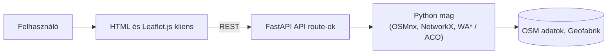

# Személyre szabott futó- és kerékpárkörök optimalizált tervezése OpenStreetMap adatok alapján

## 1) Jogosultságok
|Szerep|Igény|Felelősség/hozzáférés|
|---|---|---|
|Sportoló (felhasználó)|Egyedi útvonalak tervezése saját igényei szerint. Meg kell tudni adnia a kiindulási pontot, távolságot, maximális szintemelkedést.|Regisztrációhoz nem kötött, publikus hozzáférés a webes felülethez|
|Admin|A backend karbantartása, OSM adatok frissítése. Az utak súlyozása, megfelelő algoritmus kiválasztása a körútvonal generálásához|Teljes hozzáférés a kódhoz, adatbázishoz és a szerverhez|

## 2) Use case
- Felhasználónak meg kell adnia a kiindulási pontját (térképen kijelöléssel vagy cím beírásával), hogy onnan induljon és oda is térjen vissza az útvonal.
- Felhasználónak be kell állítania a kívánt távolságot, valamint a szintemelkedésre, burkolatra és tereptípusra vonatkozó preferenciáit.
- Felhasználónak legalább két különböző út közül kell választania, melyeket a weboldalon egy térkép fog szemléltetni.
- Adminnak le kell futtatnia a két különböző algoritmust ugyanazokkal a bemenetekkel, hogy össze tudja hasonlítani őket.

## 3) Funkcionális követelmények
|Követelmény|Elfogadási kritérium|Prioritás|
|---|---|---|
|Vizuális felület|Kezdőpont kiválasztása a térképen és a prioritások beállítása|Kötelető|
|Zárt körútvonal generálás|A gráf-központú motor a generált útvonalat a kiindulópontra viszi vissza|Kötelező|
|Alternatív útvonalak|A rendszernek legalább két különöző útvonal generálása a feladata|Kötelező|
|Adatok elemzése|A felhasználónak látnia kell az edzés részleteit annak befejeztével|Ajánlott|
|Élő adatok|Az időjárás, népszerűségi faktor és a biztonság figyelembe vétele|Ajánlott|
|Saját profil|A rendszer regisztráció után elmenti a felhasználó edzésének részleteit|Ajánlott|

## 4) Üzleti szabályok és korlátok
|Szabály vagy korlát|Indoklás|
|---|---|
|Minden útvonalnak zártnak kell lennie, kiindulási pont = érkezési pont (zárt gráf)|Körútvonal generálás alapfeltétele|
|A generált úvonal hosszának megadott hibahatáron belül kell lennie (± x%)|Ne legyen nagy eltérés a valódi úthoz képest|
|Fő algoritmusokat automatizált tesztekkel kell lefedni|Egyszerűbb tesztelés|
|Külön frontend backend, kliens-szerver kapcsolat|Modulok elkülönítése|
|Titkos kulcsok, hozzáférési tokenek, személyes adatok nem kerülhetnek a repóba|Adatok biztonsága|

## 5) Felhasználói felület és munkafolyamat
A webalkalmazás főképernyője két részre lesz osztva. Egyiken a térkép lesz látható, ahol a felhasználó ki tudja választani az indulási pontot, illetve később a megtervezett utat is itt fogja látni. A másik részen pedig csúszkákkal, checkboxokkal vagy sima szövegdobozzal lehet a saját igényeket beállítani. Lehetséges fejlesztésnél a mentett útvonalakat és a profilt egy új menüpont alatt lehet megtalálni.
Ha a felhasználó beállított mindent, a térképen két útvonal fog kirajzolódni, amelyekből választhat.
## 6) Nem funkcionális követelmények
|Követelmény|Kifejtés|Ellenőrzés módja|
|---|---|---|
|Gyors válaszidő| Városi méretű térképen a rendszer maximum 10 másodperc alatt legenerálja a kért útvonalat|Automatizált sebességtesztek futtatása, naplózása|
|Skálázhatóság| A memóriahasználat és a futási idő nem sokszorozódik meg, ha nagyobb méretű térképre váltunk|Térkép méretéhez beállított mérések, melyeket grafikonon is ábrázolunk|
|Minőség| A generált útvonal tényleg a kezdőpontra tér vissza, nem visz tiltott útra és a hossza a hibahatáron belül van|Tesztek, amelyek jelzik ha hibás a kimenet|
|Reprodukálhatóság| A rendszer ugyanazokkal paraméterekkel és térképpel ugyanazokat az útvonalakat generálja|Többszöri futtatás azonos adatokkal, majd az eredmény összehasonlítása|
|Automatizált tesztelhetőség| A főbb funkcióknak automatizált teszt írása|Teszt keretrendszer használata|
|Architektúra| Kliens-szerver architektúra miatt a modulok szétválasztása|Modulok közti függőségek ellenőrzése|
|Biztonság| Titkos jelszó, API kulcs vagy privát adat nem kerülhet a repóba|Biztonsági ellenőrző scriptek|
|Működés| A felhasználó könnyen és egyértelműen le tudja generálni a kívánt útvonalat|Pár fős felhasználói tesztelés|
|Reszponzív webdesign|Az alkalmazás elrendezése automatikusan és hibátlanul alkalmazkodik különböző képernyőméretekhez|Tesztelés a különböző felületeken|

## 7) Nyitott kérdések és kockázatok
|Kérdés/kockázat|Hatás|Felelős|Feloldás/döntés|
|---|---|---|---|
|Mekkora legyen a földrajzi lefedettsége?|Nagyban befolyásolja a memórihasználatot és a futási időt|Hallgató|Kezdésnek csak megyei adatokkal mérjük le a sebességet, és csak ezután egyeztetünk|
|Mennyire térhet el a generált kör a megadott hossztól?|Kicsi hibahatárnál a rendszer nehezebben talál útvonalat|Hallgató|Alap hibahatár (±10%), melyet a tesztelés során finomítunk|
|Hiányos térképadattal hogy járunk el?|Tervezés és statisztika hibás lehet|Hallgató|Alapértelmezett értékek az üres adatokra, hiányzó adatok felmérése|
|Hány különböző utat mutasson a térkép egyszerre?|Jelentősen lelassíthatja a választ|Hallgató|Minimum kettő utat kell mutatni,de ha belefér az időkeretbe megjelenhet több is|
|Mi van akkor, ha a rendszer nem talál utat?|Felhasználó nem kap megfelelő választ|Hallgató|A rendszer javasolja egyes preferenciák módosítását|
|Ha túl sok adatot tölt be a rendszer, jelentősen be fog lassulni|Sok várakozási idő|Hallgató|Adatok szűrése(autópályák törlése), keresés korlátozása szűkebb területre|
|Élő API vagy térkép letöltése egy fájlba?|Élő térképpel lassabb a keresés, frissítésnél romlik a reprodukálhatóság|Hallgató|Lementett kivonattal dolgozzunk, hogy megismételhető legyen az útvonal|

## 8) Kezdeti technikai javaslat
### Javasolt megoldás
Egy Python motorral működő webalkalmazás, mely egy letöltött térképből épít hálózatot(gráfot), súlyozza az útvonalakat a felhasználó kérései alapján, majd zárt köröket generál. Az eredményt egy belső API adja át a böngészőben megjelenő térképes felületnek. A backend teljesen el van választva a frontendtől.

### Technológiai irány
|Terület|Jelölt technológia/megközelítés|Döntés oka|Nyitott kérdés/kockázat|
|---|---|---|---|
|Backend|Python|Hatékony gráfalgoritmusai vannak, és könnyen fel tudja dolgozni az adatokat. Kiváló csomagokkal rendelkezik, például a OSMnx az OpenStreetMap adatok könnyebb kezeléséhez, valamint a NetwokX a gráf reprezentációhoz|Nagy térképeknél lassabb lehet mint egy C# például|
|API|FastAPI|Automatikus fejlesztői dokumentációt generál, ami megkönnyítni a frontend-backend összeköttetést|Külön figyelem a hosszú keresések kezelése|
|Frontend|HTML, CSS, Vanilla JS|CSS-nek a Flexbox/Grid lehetőségei miatt mobilon és laptopon is logikusan rendezi át a weboldal elemeit|Szimpla JS-ben a kód nehezebben olvasható lenne|
|UI|Leaflet.js|Gyorsan és könnyen lehet vele nyílt térképeket megjeleníteni, generált útvonalakat színes vonalakként kirajzolni|Figyelni kell a terhelési és felhasználási korlátokra|
|Útvonalkereső algoritmusok|1. Súlyozott A* (WA*) 2. Hangyakolónia algoritmus (ACO)|Az ACO kifejezetten a többkritériumos, hatalmas számítási feladatokra lett kitalálva. Két teljesen eltérő eljárás összevetése minőség és sebesség alapján is kiemelkedő eredményt mutathat.|Az ACO nem determinisztikus, emellett rendkívül időigényes a finomhangolása|
|Adatforrás|Letöltött Geofabrik kivonat(.pbf)|Előre letöltött regionális fájlból dolgozunk, hogy se az internetkapcsolat, se a térképmódosítás ne okozzon akadályt|Fájlok mérete óriási is lehet|
|Tesztelés|pytest, coverage|A pytest az egyik legletisztultabb Python tesztelő eszköz|Teszteket a kód írásával egy időben kell végezni, ami lassítja az indulást|
|Verziókezelés|Git|Brief által előírt Git-alapú repository|Git parancsok elsajátítása|

### Kezdeti architektúravázlat

### Megvalósíthatóság és technikai kockázatok
|Kockázat/feltételezés|2. félévre tervezett validáció|Tartalék megközelítése|
|---|---|---|
|A letöltött térképen túl sok útnál hiányozhat a burkolat vagy a meredekség|Ellenőrizzük a hiányzó adatokat, megnézzük ez mennyire nehezíti ez az útvonalgenerálást|Logikus alapértelmezett értékeket rendelünk a hiányzó szakaszokhoz|
|Ritkább úthálózaton nehezebb kihozni a körutat a hangyakolónia algoritmussal|Véletlenszerű tesztek futtatása, átlagos hibaarány dokumentációja|Hibahatár emelése, algoritmus megváltozatása|
|A gráfmotor számítási ideje és memóriaigénye túl magas lehet a webes válaszidőhöz|Térkép fokozatos növelésével megtaláljuk a rendszer teljesítményének határát|Csak a kezdőpont körüli területeket vizsgáljuk, felesleges értékeket beolvasáskor elvetjük|
|Az offline Geofabrik .pbf fileból a gráf felépítése indulások túl sok ideig tarthat|Rendszer indítási idejét megmérjük a végleges tesztterületen|Python gráfot lementjük egy helyi fileba, és később csak ezt töltjük vissza a memóriába|
|A Leaflet.js HTML térkép és a FastAPI közötti adatátvitel beakadhat|Készítünk egy minimális prototípust, hogy teszteljük az integrációt|Webes megjelenítés egyszerűsítése, algoritmusok összehasonlítását egy külön eszköz végzi|